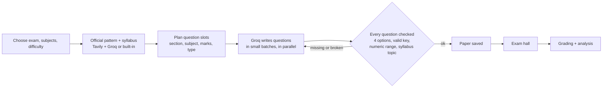
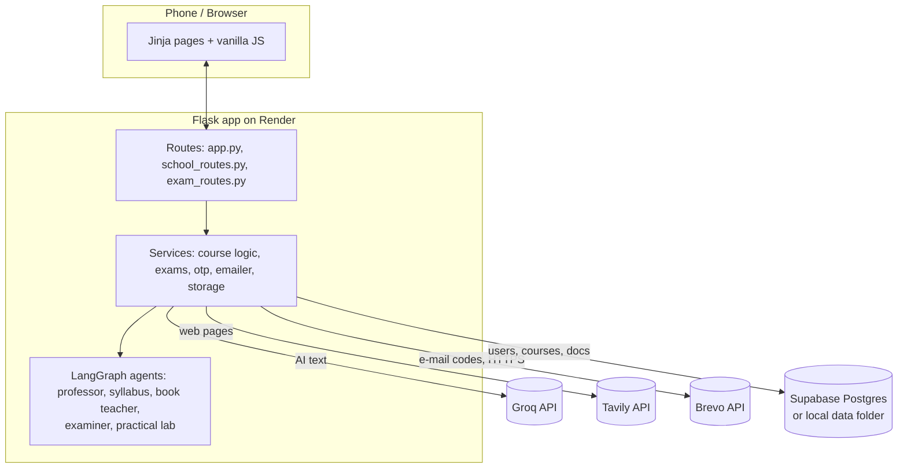

<div align="center">

# 🎓 AI विद्यालय (AI Vidyalaya)

**A free, phone-first AI study platform: personal courses, notes, books, coding lab, and real GATE / JEE / NEET / CAT mock exams in a timed exam hall.**


</div>

---

## 📑 Table of contents

1. [What is AI Vidyalaya?](#-what-is-ai-vidyalaya)
2. [Features](#-features)
3. [Exams: GATE, JEE, NEET, CAT in a real exam hall](#-exams-gate-jee-neet-cat-in-a-real-exam-hall)
4. [How it works (architecture)](#-how-it-works-architecture)
5. [Tech stack](#-tech-stack)
6. [Project structure](#-project-structure)
7. [Getting started (run on your computer)](#-getting-started-run-on-your-computer)
8. [Configuration (environment variables)](#-configuration-environment-variables)
9. [Free services you need](#-free-services-you-need)
10. [Deploy: Render + Supabase](#-deploy-render--supabase)
11. [Login and email verification](#-login-and-email-verification)
12. [Data storage](#-data-storage)
13. [Speed and phone behaviour](#-speed-and-phone-behaviour)
14. [API overview](#-api-overview)
15. [Health checks and troubleshooting](#-health-checks-and-troubleshooting)
16. [Known limits](#-known-limits)
17. [Contributing and license](#-contributing-and-license)

---

## 🌟 What is AI Vidyalaya?

AI Vidyalaya ("AI School") is a web app that gives every student a personal tutor, a study planner and an exam hall in one place. A student signs up with an email, tells the app what they study (school class, diploma, B.Tech, a competitive exam, or any skill), and the app builds:

- a **syllabus** from basics to advanced, with a **day-by-day schedule**,
- **lessons, quizzes and tests** that track what the student knows,
- **notes, book summaries and question papers** on demand,
- a **coding lab** for practical subjects,
- and **real exam-style mock tests** (GATE, JEE, NEET, CAT or any exam) with a timer, question palette, negative marking and a full analysis.

It is built to run on **free plans only** (Groq, Tavily, Brevo, Supabase, Render) and to feel fast on a phone. The interface is **English only**.

---

## ✨ Features

### 📚 Learn any subject
| Feature | What it does |
|---|---|
| **Smart chat** | Gives a direct answer instantly from built-in offline data. If there is none and a Groq key is set, it searches the web (Tavily) and Groq explains the answer in its own words. |
| **Courses** | Pick a subject, level, hours per day and days. You get modules and topics from Basic to Advanced and a **day-by-day schedule** with revision days and a final test. |
| **Lessons** | Generated once and saved, so reopening is instant. Ask questions in Professor, Tutor or Socratic style. |
| **Quizzes and tests** | Multiple-choice questions, marked instantly. Mastery is tracked per topic and a revision session is added when a topic scores below 60%. |
| **Your own material** | Upload PDF, TXT or MD files. A local keyword search (TF-IDF, no vector database) finds the matching sections and uses them in answers. |
| **Built-in subjects** | AI, ML, DSA, Calculus and Engineering Maths open instantly without any AI call. |

### 🧑‍🎓 Student tools
| Tool | What it does |
|---|---|
| **Profile and subject suggestions** | After first login the student says what they study. Groq (with Tavily web results for the real syllabus) suggests core subjects, labs, electives and skills for that exact class or semester. |
| **My Study** | Today's plan across all subjects, progress, streak, study time, weak topics and badges. |
| **Progress report card** | Topics done, mastery, grade, tests and a topic-by-topic record per subject. Printable. |
| **Topic Notes** | Exam-ready notes for any topic. |
| **Books** | Book summaries by name or from an uploaded PDF, and an **AI Book Teacher** that teaches chapter by chapter from the uploaded book with page citations and tests you on it. |
| **Exam Paper** | Custom model question papers with an answer key, **and** official exam-style mock tests (see below). |
| **Library** | Everything generated is saved and searchable. |
| **Adaptive Learning** | Personalises the learning path from performance: mastery modelling, spaced-repetition decay and dynamic difficulty. |
| **Coding Lab** | Sandboxed practice for **Python, JavaScript (Node), SQL (SQLite) and HTML/CSS preview**, companion practical courses, AI code evaluation, Socratic debugging and viva preparation. |

### 🔐 Accounts
- Sign up with **Full name + Email + Password**, verified by a **6-digit code sent by email**.
- Log in with email and password, **or with an email code (no password)**.
- **Forgot password** by email code.
- Stay logged in for 90 days on the same phone.

---

## 🎯 Exams: GATE, JEE, NEET, CAT in a real exam hall

### Exams page (`/exams`)
1. **Choose the exam and paper**: GATE (all 30 papers, for example **DA**, CS, EC, EE, ME, CE), JEE Main, JEE Advanced, NEET UG, CAT, or **Other exam** (type any name).
2. **Syllabus from the internet**: **Tavily** reads the official pages and **Groq** turns them into subjects, topics and marks. The page shows the **sources used**. Results are cached for 30 days.
3. **Study plan in one click**: every subject becomes a module, every syllabus topic a lesson, scheduled day by day for the days and hours you choose.
4. **Subject test**: a short exam-style test on one subject, sized like that subject's share of the real paper, with time in the same proportion.
5. **Full mock paper**: the complete paper.

### Exam Paper page (`/exam`) → "🎯 Exam mock test"
Select the exam, then **Full paper** or chosen subjects, then **Easy / Medium / Hard**. There is **no marks or pattern form**: the number of questions, marks, question types, negative marking and duration all come from the official pattern.

### Official pattern used (example: GATE)
| Part | Questions | Marks |
|---|---|---|
| General Aptitude | 5 × 1-mark + 5 × 2-mark = 10 | 15 |
| Technical (split over the syllabus subjects by weightage) | 25 × 1-mark + 30 × 2-mark = 55 | 85 |
| **Total** | **65** | **100** in **3 hours** |

| Type | Answer | Marking |
|---|---|---|
| **MCQ** | one correct option | wrong answer loses **1/3 of the marks** (−1/3 or −2/3) |
| **MSQ** | one or more correct options | all-or-nothing, no negative, no partial |
| **NAT** | a number typed on the keypad | accepted within a range, no negative |

Built-in patterns also cover **JEE Main** (75 Q, +4/−1, numerical without negative), **NEET UG** (180 Q, +4/−1) and **CAT** (66 Q, +3/−1, typed answers without negative). Other exams use the pattern read from the web.

### How a paper is written

Questions are **original, written in the style of the real papers** (not copied). They are written by a background job with a **progress bar**; broken or missing questions are asked for again, and MCQ options are shuffled so the correct letters are evenly spread.

### Exam hall (`/exam-hall/<paper>`)
- Instructions screen, then **full screen**.
- **Server-side countdown timer**: a refresh or a lost connection cannot reset the clock. The exam **auto-submits at zero**.
- **Section tabs** and a **question palette** (not visited, not answered, answered, marked for review, answered and marked).
- **MCQ, MSQ and NAT** with an **on-screen numeric keypad**.
- Mark for Review, Clear Response, Save & Next, **scientific calculator**, **autosave**.
- The browser **never receives the answers** before you submit.
- Works on phones (the palette opens as a side drawer).

### Result and analysis (`/exam-result/<attempt>`)
Score with negative marking, attempted / correct / wrong / skipped, accuracy, time used, **analysis by subject, section, topic (weakest first) and question type**, plain advice on what to revise, and a **review of every question** with the correct answer, explanation and time spent. Past papers and results are listed under **My exam papers**.

---

## 🧩 How it works (architecture)



- **Storage layer** (`services/storage.py`) hides where data lives: Supabase when `DATABASE_URL` is set, JSON files in `data/` otherwise.
- **AI layer** (`services/groq.py`) tries your chosen Groq model, falls back to smaller ones on rate limits, and never makes the student wait too long. A built-in offline answer finder works with no key at all.
- **Agents** (LangGraph) are loaded **only when an AI feature uses them**, so the app starts fast.

---

## 🛠 Tech stack

| Area | Technology |
|---|---|
| Backend | Python 3.10+, **Flask 3**, gunicorn |
| Frontend | Jinja2 templates, vanilla JavaScript, one CSS file (mobile-first, no framework) |
| AI | **Groq** (default model `openai/gpt-oss-120b` with automatic fallbacks), LangChain + **LangGraph** agents |
| Web search | **Tavily** |
| Retrieval | Local **TF-IDF** (no vector database, no embeddings API) |
| Database | **Supabase Postgres** (psycopg 3 + connection pool) or local JSON files |
| E-mail | **Brevo** HTTPS API (SMTP fallback for local use) |
| Hosting | **Render** (free web service) |

---

## 📁 Project structure

```
AI-Vidhyalaya/
├── app.py                  # main app: pages, login, chat, courses, caching + gzip
├── school_routes.py        # profile, My Study, Notes, Books, Exam Paper, Library, Lab, Adaptive
├── exam_routes.py          # Exams page, exam hall, results and /api/exams/*
├── services/
│   ├── groq.py             # Groq client with model fallback and rate-limit handling
│   ├── websearch.py        # Tavily wrapper (cached)
│   ├── storage.py          # users, courses, docs: Supabase or local files, with caching
│   ├── db.py               # Postgres connection pool and SQL
│   ├── config.py           # settings from .env / environment
│   ├── course_logic.py     # syllabus normalising and day-by-day schedule builder
│   ├── exams.py            # exam engine: syllabus, paper planning, writing, grading, analysis
│   ├── exam_data.py        # exam catalog, built-in syllabi and patterns
│   ├── otp.py              # 6-digit email codes (hashed, limits, lockout)
│   ├── emailer.py          # Brevo / SMTP sender
│   ├── book_teacher.py     # uploaded books: index, teach, test
│   ├── rag.py              # PDF/TXT/MD extraction, chunking, TF-IDF search
│   ├── adaptive.py         # mastery, spaced repetition, difficulty
│   ├── lab_service.py      # sandboxed code runner and lab exercises
│   ├── test_evaluator.py   # answer checking and rubrics
│   ├── knowledge.py        # built-in course library (_cache.dat) *
│   ├── mockllm.py          # offline answer finder
│   └── agentic/            # LangGraph agents (professor, syllabus, book teacher, examiner, practical)
├── templates/              # Jinja pages (index, study, course, lesson, books, exams, exam_hall ...)
├── static/
│   ├── css/style.css
│   └── js/                 # common, home, books, examtools, examhall, examresult, lab ...
├── data/                   # local storage (users.json ships with demo accounts)
├── supabase_schema.sql     # database tables (also created automatically)
├── render.yaml             # one-click Render blueprint
├── Procfile                # gunicorn start command
├── requirements.txt
├── .env.example            # all settings explained
├── start.bat / start.sh    # one-click local start
├── check_db.py / diagnose.py
└── CHANGES.md              # detailed change log
```
\* `services/_cache.dat` (the built-in course library) must be present in `services/` for the built-in subjects. Without it the app still runs and uses the AI instead.

---

## 🚀 Getting started (run on your computer)

**Needs Python 3.10 or newer.**

```bash
# 1. get the code
git clone https://github.com/<your-user>/AI-Vidhyalaya.git
cd AI-Vidhyalaya

# 2. one-click start
#    Windows: double-click start.bat
#    Mac / Linux:
./start.sh
```

Or manually:

```bash
python -m venv venv
source venv/bin/activate          # Windows: venv\Scripts\activate
pip install -r requirements.txt
cp .env.example .env              # then add your keys (all are optional to start)
python app.py
```

Open **http://127.0.0.1:5000**.

The app works **without any key** (offline answers, built-in subjects). Add keys to unlock AI features:

| You add | You unlock |
|---|---|
| `GROQ_API_KEY` | AI chat, any-subject courses, lessons, notes, books, exam papers |
| `TAVILY_API_KEY` | live web syllabus for any exam or subject |
| `BREVO_API_KEY` + `MAIL_FROM` | real email codes (locally the code is printed in the terminal instead) |

### Demo accounts
Five accounts are ready for local testing: `bijay`, `ayush`, `pragyansh`, `pushpendra`, `vaishnavi`, all with password `12345` (type the name in the email box). **Delete or change them before a public deployment** (`data/users.json`). New users sign up with email verification.

---

## ⚙️ Configuration (environment variables)

Copy `.env.example` to `.env` locally; on Render set them under **Environment**. **Never commit a real `.env`.**

| Variable | Required | Purpose |
|---|---|---|
| `DATABASE_URL` | for deployment | Supabase **Session pooler** connection string. Without it, data is stored in `data/` (erased on Render restarts). |
| `SECRET_KEY` | for deployment | Signs login cookies. Keep it fixed so logins survive restarts. Generate: `python -c "import secrets; print(secrets.token_hex(32))"` |
| `GROQ_API_KEY` | for AI | Free key from console.groq.com |
| `GROQ_MODEL` | no | Default `openai/gpt-oss-120b` (smaller models are used automatically when rate-limited) |
| `TAVILY_API_KEY` | for web syllabus | Free key from app.tavily.com |
| `BREVO_API_KEY` | for email codes | Brevo **API key** (not the SMTP or MCP key) |
| `MAIL_FROM` | for email codes | Sender address you **verified in Brevo** |
| `MAIL_FROM_NAME` | no | Display name, default `AI Vidyalaya` |
| `SMTP_HOST`, `SMTP_PORT`, `SMTP_USER`, `SMTP_PASSWORD` | local only | SMTP fallback (blocked on Render's free plan) |
| `OFFLINE_FIRST` | no | Default `0`: Groq and web search are used first. `1` = use the built-in offline data first |
| `DB_POOL_MAX` | no | Max database connections, default 6 |

---

## 🆓 Free services you need

| Service | Used for | Free plan | Setup |
|---|---|---|---|
| **Groq** | all AI text | free tier with per-minute limits | create a key at console.groq.com/keys |
| **Tavily** | reading official syllabus pages | free credits, no card | key at app.tavily.com |
| **Brevo** | sending 6-digit codes | 300 emails/day, no card, no domain | Senders → add and **verify** your email, then SMTP & API → **API keys** |
| **Supabase** | saving users, courses, results | free project | Connect → **Session pooler** string |
| **Render** | hosting | free web service | deploy from GitHub (see below) |
| **UptimeRobot** (optional) | keeps Render awake | free | monitor `https://YOUR-APP.onrender.com/ping` every 10 minutes |

> **Why Brevo's API and not SMTP?** Render's free plan blocks outgoing SMTP ports (25, 465, 587), so email is sent over HTTPS.
> **Gmail as sender:** works, but codes may land in spam because Brevo cannot sign Gmail domains. Tell users to check spam, or use your own domain later.

---

## ☁️ Deploy: Render + Supabase

1. **Supabase**: create a project → **Connect** → copy the **Session pooler** connection string (not the "Direct" one, which Render cannot reach) and put your database password in it. Tables are created automatically on first start (`supabase_schema.sql` has the same SQL).
2. **GitHub**: push this folder. `.gitignore` keeps `.env` and `data/` out (but allows `services/_cache.dat`).
3. **Render**: **New → Blueprint** (uses `render.yaml`), or **New → Web Service** with
   - Build: `pip install -r requirements.txt`
   - Start: `gunicorn app:app --workers 1 --threads 8 --timeout 120 --keep-alive 5 --worker-tmp-dir /dev/shm --bind 0.0.0.0:$PORT`
4. **Environment** on Render: `DATABASE_URL`, `GROQ_API_KEY`, `TAVILY_API_KEY`, `BREVO_API_KEY`, `MAIL_FROM` (`SECRET_KEY` is generated for you).
5. **Check**: open `https://YOUR-APP.onrender.com/health`. You should see `"storage": "database"` and `"saved_and_read_back": true`. Inside the app, the profile menu says **All your data is saved in the database**.

> Keep **one gunicorn worker**: the app serialises course updates and runs paper-writing jobs inside one process.
> Free Render servers **sleep after 15 minutes** without visitors; the next visit takes about a minute. A free uptime monitor on `/ping` avoids this.

---

## 🔐 Login and email verification

| Flow | Steps |
|---|---|
| **Sign up** | Full name + email + password → 6-digit code by email → account created only after the code is entered. One account per email. |
| **Log in** | Email + password. |
| **Log in with email code** | Email → code → logged in (no password). |
| **Forgot password** | Email → code + new password. |

Code safety: stored only as a **keyed hash**, valid **10 minutes**, **5 wrong tries** then a new code is needed, resend after **60 seconds**, at most **5 codes per hour per email** and 20 requests per hour per device. "Forgot password" and "code login" answer the same for unknown emails, so nobody can discover who is registered. Passwords are stored hashed.

---

## 🗄 Data storage

| Mode | When | Where |
|---|---|---|
| **Database** | `DATABASE_URL` is set | Supabase Postgres tables `users`, `courses`, `materials`, `docs`, `app_secrets` |
| **Local files** | no `DATABASE_URL` | JSON files in `data/` |

Per-user records (profile, library, notes, exam papers, attempts and results, uploaded books, activity) live in the `docs` table. Each person sees only their own data. A small in-memory cache (30–60 seconds, cleared on every write) keeps pages fast.

---

## ⚡ Speed and phone behaviour

- Static files are **cached for a year** (versioned URLs) and pages, CSS, JS and JSON are **gzip compressed**.
- A page makes only **1–4 database calls**; "my courses" is filtered inside the database (indexed).
- The database pool has **no extra check query** per request and keeps connections alive.
- Heavy AI libraries load **only when used**.
- Phone layout: bottom navigation bar, 16 px inputs (no zoom on iPhone), no tap delay, no blur effects on small screens, a **loading bar the moment a menu item is tapped**, tested down to **320 × 480**.
- The keyboard never opens by itself on phones.

---

## 🔌 API overview

All APIs return JSON. Everything except login, sign up and health requires a logged-in user.

| Area | Endpoints |
|---|---|
| **Auth** | `POST /api/login` · `/api/signup/start` · `/api/signup/verify` · `/api/otp/resend` · `/api/forgot/start` · `/api/forgot/verify` · `/api/login/otp/start` · `/api/login/otp/verify` · `/api/resume` · `/api/logout` |
| **Exams** | `POST /api/exams/info` · `/api/exams/generate` · `/api/exams/prepare` · `GET /api/exams/paper/<id>/status` · `/api/exams/paper/<id>/meta` · `/api/exams/papers` |
| **Exam hall** | `POST /api/exams/attempt/start` · `/api/exams/attempt/<id>/save` · `/api/exams/attempt/<id>/submit` · `GET /api/exams/attempt/<id>/result` |
| **Books** | `GET /api/books/list` · `POST /api/books/upload` |
| **Health** | `GET /health` · `/api/health` · `/ping` |

Main pages: `/` · `/study` · `/course/<id>` · `/notes` · `/books` · `/exam` · `/exams` · `/exam-hall/<id>` · `/exam-result/<id>` · `/progress` · `/library` · `/lab` · `/adaptive`.

---

## 🩺 Health checks and troubleshooting

- `/health` shows the storage mode and a database write-and-read test; `/ping` is a light keep-alive address; `python check_db.py` tests `DATABASE_URL` from your computer (prints PASS or the exact problem); `python diagnose.py` shows exactly where Groq or web search fail on your computer.
- Watch the terminal: every AI call prints its model, status and time, and a self-test runs at start-up (`OK:` or `PROBLEM:`).

| Problem | Fix |
|---|---|
| Home page shows an error | Copy `services/_cache.dat` into `services/`, or ignore it: the app still runs. |
| "Groq rejected the API key" | Check for extra spaces or quotes in the key. |
| "Rate limit reached" | Free tier has per-minute limits. Wait a minute. Exam papers retry automatically. |
| Email code does not arrive | Check spam. Check `MAIL_FROM` is the address **verified in Brevo** and `BREVO_API_KEY` is the **API key**. Look for `Brevo error` in the Render logs. |
| "E-mail sending is not set up yet" | Add `BREVO_API_KEY` and `MAIL_FROM` on Render. |
| Data disappears after a restart | `DATABASE_URL` is missing. Check `/health`. |
| Scanned PDF cannot be read | Use a PDF with selectable text (max 25 MB). |
| First visit is very slow | Render free sleeps. Add an uptime monitor for `/ping`. |
| Exam paper "was not finished" | The server restarted while writing. Generate it again. |

---

## ⚠️ Known limits

- **AI can make mistakes.** Generated lessons, questions and answer keys should be reviewed, especially before real exams.
- Exam papers are **original questions in the official style**, not past papers. Subject weightage for GATE DA and CS is **approximate**. GATE XE/XL/XH optional sections, JEE Advanced partial marking and CAT sectional timers are not modelled exactly.
- Free plans have limits: Groq per-minute rate limits (a full 65-question paper takes about 1–3 minutes), Brevo 300 emails/day, Render sleeping.
- The interface is **English only**.
- Paper writing runs inside the app process, so keep one worker.

---

## 🤝 Contributing and license

Ideas and pull requests are welcome: open an issue describing the change first. See [`CHANGES.md`](CHANGES.md) for the history of changes and the reasoning behind them.

**License:** no license file is included yet. Add one (for example MIT) before making the repository public.

<div align="center">

Made for students · runs on free plans · works on your phone 📱

</div>
